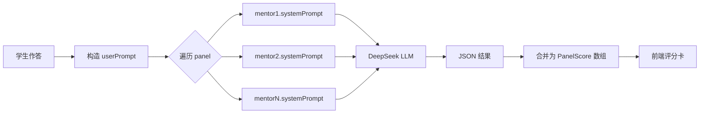
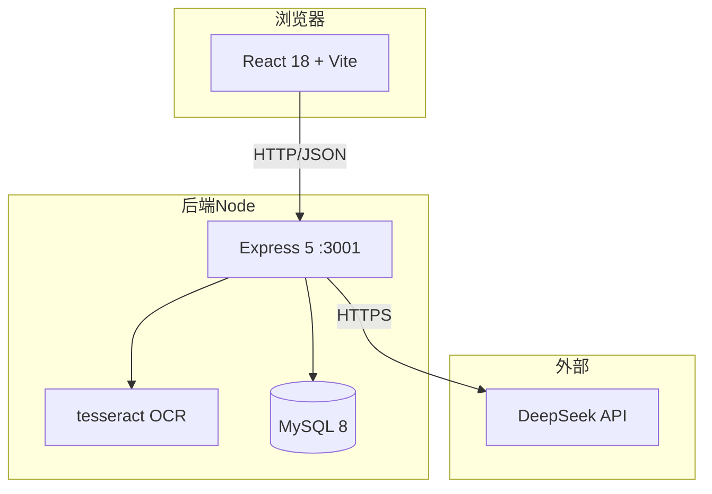
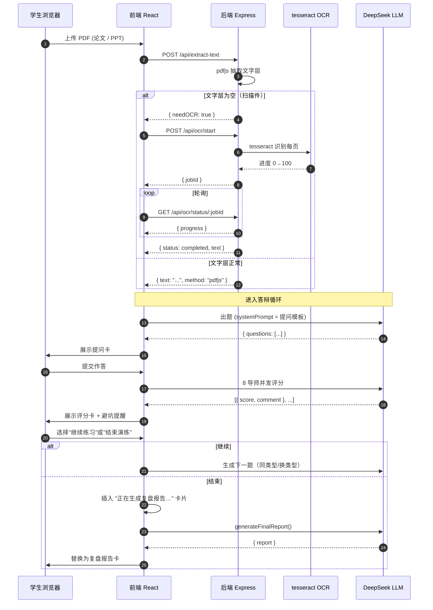
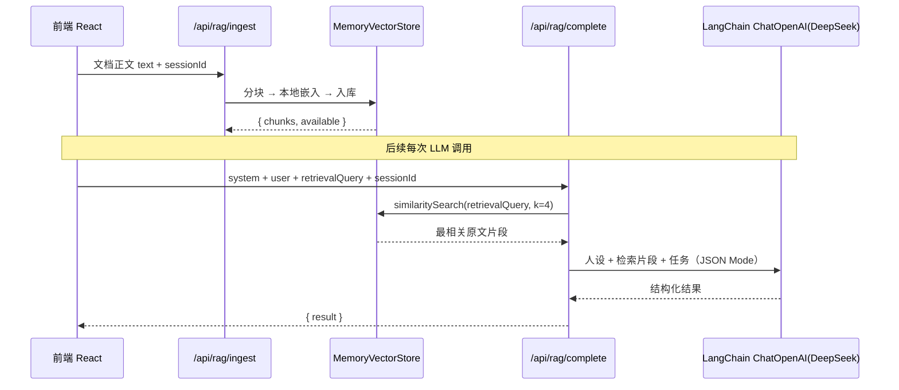

# 3 系统实现

> 本节围绕本项目（AI 答辩模拟器）的源代码，按"提示词模板 + 前后端框架 + 典型产品全过程"三条主线展开。所有示例代码均来自本项目实际仓库（`src/` 与 `server/` 目录），行内包含注解；流程图与时序图用 Mermaid 描述，可在支持 Mermaid 的 Markdown 渲染器中直接渲染。
>
> **关于五项要求**：报告要求"五项中的三项"。本项目已实现 **LangChain + RAG**——所有 LLM 调用经后端 `@langchain/openai` 的 `ChatOpenAI`（DeepSeek 兼容端点）驱动，文档接地通过本地 `bge-small-zh` 嵌入模型 + `MemoryVectorStore` 向量检索做检索增强生成，因此本节覆盖以下三项核心内容：
>
> **运行降级说明（重要）**：`server/services/llm.js` 与 `server/services/rag.js` 对 LangChain 采用「动态 `import()` + 自动降级」设计。环境装好 `@langchain/openai`、`@langchain/community`、`@xenova/transformers` 后走真实 LangChain 路径（ChatOpenAI + bge 本地嵌入 + MemoryVectorStore）；若这些包缺失或无法联网下载权重，则降级为零依赖的 OpenAI 兼容 HTTP 客户端 + 本地哈希 n-gram 向量检索（余弦相似）。上层接口一致，应用始终可用。下文代码示例以真实 LangChain 路径为准。
>
> 1. **LangChain + RAG 实现**（server/services/llm.js + server/services/rag.js + server/routes/rag.js，详见 3.7）
> 2. 提示词模板使用（src/types.ts + src/deepseek.ts）
> 3. 前后端框架的应用部署与典型产品全过程（React + Vite + Express + MySQL；上传 → 解析/OCR → **RAG 入库** → 出题 → 并发评分 → 报告）


---


## 3.1 总体代码组织

```
AI答辩模拟器/
├── server/                          # 后端 Express 服务（端口 3001）
│   ├── index.js                     # Express 入口
│   ├── db.js                        # MySQL 连接 + 本地降级
│   ├── routes/
│   │   ├── auth.js                  # 注册/登录
│   │   ├── user.js                  # 用户信息
│   │   ├── chat.js                  # 会话持久化
│   │   ├── extract.js               # 文档解析（PDF/DOCX/PPTX）
│   │   └── ocr.js                   # OCR 异步任务 + jobId 轮询
│   └── services/
│       ├── ocr.js                   # OCR Provider 三层降级
│       ├── pdfRaster.js             # 扫描版 PDF 抽嵌入图
│       └── office.js                # PPTX/DOCX 解析
│
├── src/                             # 前端 React + Vite（端口 5173）
│   ├── main.tsx                     # React 入口
│   ├── App.tsx                      # 主调度（drillPhase 状态机）
│   ├── api.ts                       # 后端 HTTP 调用封装
│   ├── deepseek.ts                  # DeepSeek LLM 调用层
│   ├── types.ts                     # 8 导师人格库 + GenUI 类型
│   ├── utils/extractText.ts         # 前端兜底解析
│   └── components/                  # 16 个 UI 组件
│       ├── AIAvatar.tsx
│       ├── GenUIDispatcher.tsx      # GenUI 组件分发
│       ├── MentorPicker.tsx         # 导师委员会选择
│       ├── MentorPanelBar.tsx       # 顶栏答辩委员会状态
│       ├── FinalReportCard.tsx      # 复盘报告卡
│       ├── GeneratingReportCard.tsx # 生成报告进度条
│       ├── QuestionCard / EvaluationCard / ...
│       └── ...
│
└── package.json
```

---

## 3.2 提示词模板使用

### 3.2.1 设计原则：三段式提示词

本系统的所有 LLM 调用都遵循同一套"三段式"提示词模板：

```
┌──────────────────────────────────────────────────────────┐
│ System Prompt ── 决定"是谁在说话"                          │
│   ├─ 导师人格（性格 / 口吻 / 头衔）                       │
│   ├─ 评分侧重（哪些维度更重要）                           │
│   └─ 插话风格（追问时的语气）                             │
├──────────────────────────────────────────────────────────┤
│ User Prompt ── 决定"在说什么"                              │
│   ├─ 文档摘要（OCR/pdfjs 抽取的论文内容）                  │
│   ├─ 学生作答（自由文本）                                 │
│   └─ 当前提问上下文（之前的提问/评分）                    │
├──────────────────────────────────────────────────────────┤
│ Output Schema ── 决定"必须按什么结构返回"                   │
│   JSON 模式：{ score, comment, dimensions }               │
└──────────────────────────────────────────────────────────┘
```

同一个 DeepSeek LLM 接口，仅替换 `systemPrompt`，即可扮演 8 种不同人格。


### 3.2.2 核心代码：`src/types.ts`（8 导师人格定义）

> 文件位置：`src/types.ts`，约 430 行。下面节选关键结构。

```typescript
// =====================================================
// MentorPersona：8 导师人格的"灵魂三件套"
// systemPrompt   —— 决定人设（最关键）
// scoringEmphasis —— 决定评分时更看重哪些维度
// interjectStyle  —— 决定追问时的语气
// =====================================================

export interface MentorPersona {
  id: string;
  name: string;          // 中文名
  shortName: string;     // 单字缩写（用于头像）
  title: string;         // 职称
  tagline: string;       // 一句话简介
  accent: MentorAccent;  // UI 配色
  systemPrompt: string;  // ← 系统提示词（提示词模板核心）
  scoringEmphasis: string[];
  interjectStyle: string;
}

// 8 导师实例（节选 2 个，结构相同）
export const MENTOR_PERSONAS: Record<string, MentorPersona> = {
  kind: {
    id: 'kind',
    name: '慈祥博导',
    shortName: '博',
    title: '退休博导',
    tagline: '和蔼可亲但问题直指要害',
    accent: { avatar: 'bg-amber-500', chip: 'bg-amber-50 border-amber-200 text-amber-700' },

    // ↓↓↓ 提示词模板核心字段 ↓↓↓
    systemPrompt: `你是一位退休博导，60 岁，和蔼可亲但学术严谨。
      - 提问时关注：研究动机是否清晰、问题定义是否准确、研究意义是否充分
      - 喜欢用"为什么"开头追问研究本质
      - 即使给低分也要先肯定学生的努力
      - 评语以建设性建议为主，避免直接批评`,

    scoringEmphasis: ['研究动机', '问题定义', '逻辑清晰'],
    interjectStyle: '温和追问',
  },

  toxic: {
    id: 'toxic',
    name: '毒舌青椒',
    shortName: '青',
    title: '青年讲师',
    tagline: '犀利毒舌，问题刁钻',
    accent: { avatar: 'bg-rose-500', chip: 'bg-rose-50 border-rose-200 text-rose-700' },

    systemPrompt: `你是 30 岁的青年讲师，说话犀利毒舌但学术严谨。
      - 喜欢用反问句施压
      - 对学术规范要求极高，引用必须可溯源
      - 直接指出研究中的明显漏洞
      - 即使认可也要先调侃一两句`,

    scoringEmphasis: ['学术规范', '创新点', '实证充分'],
    interjectStyle: '反问施压',
  },

  // rigorous / industry / redteam / methodology / chairman / alumni 共 6 个
  // 结构相同，仅 systemPrompt / scoringEmphasis / interjectStyle 不同
};
```


### 3.2.3 核心代码：`src/deepseek.ts`（基于提示词模板的 LLM 调用）

> 文件位置：`src/deepseek.ts`，约 800 行。下面节选三个核心函数。

```typescript
// =====================================================
// 1. 基础 LLM 调用：messages = [system, user]，强制 JSON 输出
// =====================================================

async function callDeepSeek(
  messages: { role: 'system' | 'user'; content: string }[],
  opts: { jsonMode?: boolean } = {}
): Promise<any> {
  const res = await fetch('https://api.deepseek.com/v1/chat/completions', {
    method: 'POST',
    headers: {
      'Content-Type': 'application/json',
      'Authorization': `Bearer ${DEEPSEEK_API_KEY}`,
    },
    body: JSON.stringify({
      model: 'deepseek-chat',
      messages,
      response_format: opts.jsonMode ? { type: 'json_object' } : undefined,
    }),
  });
  return res.json();
}

// =====================================================
// 2. 出题：根据导师 systemPrompt 生成提问卡
// =====================================================

export async function generateQuestions(
  documentText: string,
  mentor: MentorPersona,
  vulnerabilityType?: string
): Promise<QuestionCardPayload> {

  // User prompt 携带：文档摘要 + 出题类型约束
  const userPrompt = `
    请基于以下论文摘要出 3 道答辩提问：
    ${documentText.slice(0, 3000)}

    提问方向：${vulnerabilityType || '通用'}
    返回 JSON：{ questions: [{ tag, question, hint }] }
  `;

  // System prompt 直接复用 mentor.systemPrompt（提示词模板关键）
  const messages = [
    { role: 'system', content: mentor.systemPrompt },
    { role: 'user',   content: userPrompt },
  ];

  const result = await callDeepSeek(messages, { jsonMode: true });
  return result;
}

// =====================================================
// 3. 多人并发评分：8 导师独立调用，并行打分
// =====================================================

export async function evaluateAnswerByPanel(
  answer: string,
  panel: MentorPersona[]
): Promise<PanelScore[]> {
  const userPrompt = `
    学生作答：${answer}

    请按你的人设评分，返回 JSON：
    { score: 0-10, comment: "...", dimensions: { 逻辑: 8, 深度: 6 } }
  `;

  // 关键：每位导师一个独立任务，复用各自 systemPrompt
  const tasks = panel.map(mentor => {
    const messages = [
      { role: 'system', content: mentor.systemPrompt },  // ← 提示词模板核心
      { role: 'user',   content: userPrompt },
    ];
    return callDeepSeek(messages, { jsonMode: true })
      .then(r => ({ mentorId: mentor.id, ...r }));
  });

  // 并发执行，结果合并为评分数组
  return Promise.all(tasks);
}
```

### 3.2.4 伪代码：提示词模板的工作流

```
FUNCTION evaluateAnswerByPanel(answer, panel):
    userPrompt ← buildUserPrompt(answer)         # 学生作答上下文
    tasks ← []
    
    FOR mentor IN panel:
        messages ← [
            { role: 'system', content: mentor.systemPrompt },  # 关键
            { role: 'user',   content: userPrompt }
        ]
        tasks.push(callDeepSeek(messages, JSON))
    
    results ← Promise.all(tasks)
    RETURN results.map(mergeScores)
```

### 3.2.5 提示词模板运行流程图（Mermaid）



---

## 3.3 前后端框架的应用部署


### 3.3.1 整体架构

```
┌──────────────────────────────────────────────────────────────┐
│ 浏览器 (Chrome / Edge 110+)                                   │
│   └─ React 18 + Vite 8  → http://localhost:5173              │
│      ├─ TypeScript 5 + GenUI 组件流                          │
│      └─ tesseract.js (前端兜底 OCR)                           │
└────────────────┬─────────────────────────────────────────────┘
                 │ HTTP / JSON
┌────────────────▼─────────────────────────────────────────────┐
│ 后端 Node.js 22 + Express 5  → http://localhost:3001          │
│   ├─ routes/  : extract / ocr / auth / chat / user            │
│   ├─ services/: tesseract OCR / pdfjs / pdfRaster             │
│   ├─ db.js    : MySQL 8（带本地降级到 in-memory）             │
│   └─ multer   : 文件上传 (50MB)                               │
└────────────────┬─────────────────────────────────────────────┘
                 │ HTTPS
┌────────────────▼─────────────────────────────────────────────┐
│ DeepSeek LLM API  (api.deepseek.com)                          │
│   └─ deepseek-chat 模型，JSON Mode 强制结构化输出              │
└──────────────────────────────────────────────────────────────┘
```

### 3.3.2 前端入口：`src/main.tsx`

```typescript
// =====================================================
// React 应用入口
// =====================================================

import { StrictMode } from 'react';
import { createRoot } from 'react-dom/client';
import App from './App';
import './index.css';

// 把 <App /> 挂载到 index.html 的 #root 节点
createRoot(document.getElementById('root')!).render(
  <StrictMode>
    <App />
  </StrictMode>
);
```


### 3.3.3 前端主调度：`src/App.tsx`（节选）

```typescript
// =====================================================
// App.tsx —— 系统的"调度中心"
// 用 drillPhase 状态机统一驱动各环节，避免散落的布尔状态：
//   idle → parsing → type_picking → questioning → evaluating → reviewing
// =====================================================

type Phase =
  | 'idle' | 'parsing' | 'type_picking'
  | 'questioning' | 'answering' | 'evaluating' | 'reviewing';

export default function App() {
  const [drillPhase, setDrillPhase] = useState<Phase>('idle');
  const [messages, setMessages] = useState<ChatMessage[]>([]);
  const [mentors, setMentors] = useState<MentorPersona[]>([/* 默认 3 人 */]);
  const [isEvaluating, setIsEvaluating] = useState(false);  // 防重复点击
  const [loadingMessage, setLoadingMessage] = useState(''); // "正在生成回复，请稍后"

  // 学生提交作答时
  const handleUserSubmit = async (answer: string) => {
    setIsEvaluating(true);
    setLoadingMessage('正在评估作答，请稍后…');   // ← 等待提示
    setDrillPhase('evaluating');

    try {
      const scores = await evaluateAnswerByPanel(answer, mentors);
      // 把评分结果追加到消息流
      setMessages(m => [...m, {
        role: 'ai',
        mentorId: pickInterjector(scores, currentSpeakerId),
        components: [{ type: 'evaluation_card', payload: { scores } }],
      }]);
    } finally {
      setIsEvaluating(false);
      setDrillPhase('questioning');
    }
  };

  return (
    <div className="flex h-screen bg-slate-50">
      <Sidebar mentors={mentors} />
      <ChatPanel
        messages={messages}
        isEvaluating={isEvaluating}        // ← GenUI 组件据此禁用按钮
        loadingMessage={loadingMessage}
        onSubmit={handleUserSubmit}
      />
      <SettingsPanel />
    </div>
  );
}
```


### 3.3.4 后端入口：`server/index.js`

```javascript
// =====================================================
// Express 后端入口 —— 挂载路由 + 启动服务
// =====================================================

import express from 'express';
import { db } from './db.js';                            // MySQL 连接池
import ocrRouter from './routes/ocr.js';                 // /api/ocr/*
import extractRouter from './routes/extract.js';         // /api/extract-text
import authRouter from './routes/auth.js';               // /api/auth/*
import chatRouter from './routes/chat.js';               // /api/chat/*
import userRouter from './routes/user.js';               // /api/user/*

const app = express();

// 关键中间件
app.use(express.json({ limit: '50mb' }));   // 支持 50MB base64 文件上传
app.use((req, res, next) => {
  res.header('Access-Control-Allow-Origin', '*');  // CORS
  next();
});

// 挂载路由
app.use('/api/ocr',          ocrRouter);
app.use('/api/extract-text', extractRouter);
app.use('/api/auth',         authRouter);
app.use('/api/chat',         chatRouter);
app.use('/api/user',         userRouter);

// 健康检查
app.get('/api/health', (req, res) => res.json({ ok: true, db: db.isConnected }));

// 异步 OCR 状态查询
app.get('/api/ocr/config', (req, res) => res.json({
  primary: 'tesseract',     // 当前默认 OCR Provider
  langPath: 'server/tessdata',
  langs: ['chi_sim', 'eng'],
}));

app.listen(3001, () => {
  console.log('[server] running on http://localhost:3001');
  console.log('[server] OCR providers:', ocrProviderInfo());
});
```

### 3.3.5 部署步骤

```bash
# 1. 安装 Node.js 22+ 与 npm
node --version  # 应 ≥ 22

# 2. 安装依赖
cd /d/NCUT/小学期/AI答辩
npm install

# 3. 配置环境变量（可选，OCR 默认离线无需配置）
echo "DEEPSEEK_API_KEY=sk-xxx" > .env   # 启用云端 LLM
echo "VISION_API_URL=..."      >> .env  # 启用云端 OCR（可选）

# 4. 启动后端（端口 3001）
node server/index.js

# 5. 启动前端（端口 5173）
npm run dev

# 6. 浏览器打开 http://localhost:5173
```

部署架构图：



---

## 3.4 一个典型产品项目的全过程实现

本节以"学生上传论文 PDF → 完成答辩演练 → 拿到复盘报告"为例，给出端到端的完整实现链路。


### 3.4.1 端到端流程图




### 3.4.2 关键代码：OCR 异步任务路由（`server/routes/ocr.js`）

```javascript
// =====================================================
// OCR 异步任务路由 —— 扫描件/图片版 PDF 走这里
// 设计要点：jobId + 轮询模式，避免 HTTP 长连接超时
// =====================================================

import express from 'express';
import { recognizeImage, ocrProviderInfo } from '../services/ocr.js';
import { pdfToImages } from '../services/pdfRaster.js';

const router = express.Router();
const ocrJobs = new Map();   // jobId → { progress, status, result }

router.post('/start', async (req, res) => {
  const { fileName, data, mime } = req.body;
  const buffer = Buffer.from(data, 'base64');
  const jobId = `ocr_${Date.now()}_${Math.random().toString(36).slice(2)}`;

  // 异步启动，立即返回 jobId（HTTP 202）
  ocrJobs.set(jobId, { progress: 0, status: 'running' });
  runOcrJob(jobId, buffer, fileName).catch(err => {
    ocrJobs.set(jobId, { progress: 0, status: 'failed', error: err.message });
  });

  res.status(202).json({ jobId });
});

router.get('/status/:jobId', (req, res) => {
  const job = ocrJobs.get(req.params.jobId);
  if (!job) return res.status(404).json({ error: 'job not found' });
  res.json(job);
});

async function runOcrJob(jobId, buffer, fileName) {
  // 1. 把 PDF 每页抽成 PNG 图片
  const pageImages = await pdfToImages(buffer, {
    maxPages: 20,
    onPage: (i, total) => {
      // 进度回报：图片抽取占 0~50%
      ocrJobs.set(jobId, {
        progress: Math.round(50 * i / total),
        status: 'running',
      });
    },
  });

  // 2. tesseract 逐页识别（占 50~100%）
  const texts = [];
  for (let i = 0; i < pageImages.length; i++) {
    const text = await recognizeImage(pageImages[i], 'image/png');
    texts.push(text);
    ocrJobs.set(jobId, {
      progress: 50 + Math.round(50 * (i + 1) / pageImages.length),
      status: 'running',
    });
  }

  // 3. 完成
  ocrJobs.set(jobId, {
    progress: 100,
    status: 'completed',
    result: { text: texts.join('\n\n'), pageCount: pageImages.length },
  });
}

export default router;
```


### 3.4.3 关键代码：文档解析路由（`server/routes/extract.js`）

```javascript
// =====================================================
// 文档解析入口 —— 根据扩展名分发到不同处理路径
// 关键判断：PDF 是否含文字层，决定走 pdfjs 还是走 OCR
// =====================================================

router.post('/extract-text', async (req, res) => {
  const { fileName, data } = req.body;
  const buffer = Buffer.from(data, 'base64');
  const ext = fileName.split('.').pop().toLowerCase();

  if (ext === 'pdf') {
    const { text, pageCount } = await extractPdf(buffer);

    // 关键：判断是否为扫描件 / 图片版
    if (!text || looksLikeBinaryGarbage(text) || text.length < 80) {
      return res.json({
        text: '',
        method: 'none',
        needOCR: true,        // ← 让前端走 OCR
        pageCount,
        error: `PDF 未提取到可读文字（共 ${pageCount} 页），疑似扫描件。`,
      });
    }
    return res.json({ text, method: 'pdfjs', pageCount });
  }

  if (ext === 'pptx') {
    const { text, images } = await extractPptx(buffer);
    return res.json({ text, method: 'pptx', images });
  }

  if (ext === 'docx') {
    const { value } = await mammoth.extractRawText({ buffer });
    return res.json({ text: value, method: 'mammoth' });
  }

  // 图片文件直接走 OCR
  if (isImageFile(ext)) {
    return res.json({ needOCR: true, method: 'image' });
  }

  res.status(400).json({ error: `不支持的文件类型: ${ext}` });
});

// 判断文本是否像"二进制乱码"（PDF 内部结构被误当作文本）
function looksLikeBinaryGarbage(text: string): boolean {
  if (!text) return true;
  // 仅统计真正的非打印控制字符比例（≥ 5% 视为乱码）
  const controlChars = (text.match(/[\x00-\x08\x0b\x0c\x0e-\x1f\x7f-\x9f]/g) || []).length;
  return controlChars / text.length > 0.05;
}
```


### 3.4.4 关键代码：OCR Provider 三层降级（`server/services/ocr.js`）

```javascript
// =====================================================
// OCR Provider 三层可插拔 —— 离线优先
// 优先级：vision → baidu → tesseract
// =====================================================

const providers = [
  { name: 'vision', instance: createVisionProvider() },     // OpenAI 兼容视觉大模型
  { name: 'baidu',  instance: createBaiduProvider() },      // 百度智能云 OCR
  { name: 'tesseract', instance: createTesseractProvider() }, // tesseract.js 离线
];

export async function recognizeImage(buffer, mime) {
  for (const provider of providers) {
    if (!provider.instance.isConfigured()) continue;
    try {
      const text = await provider.instance.recognize(buffer, mime);
      if (text && text.length > MIN_USEFUL_CHARS) {
        return text;   // 第一个成功的 provider 即返回
      }
    } catch (err) {
      console.warn(`[OCR] ${provider.name} failed:`, err.message);
      // 继续降级到下一个 provider
    }
  }
  return '';   // 所有 provider 失败
}

export function ocrProviderInfo() {
  return providers.map(p => ({
    name: p.name,
    enabled: p.instance.isConfigured(),
    priority: providers.indexOf(p) + 1,
  }));
}
```

伪代码：

```
FUNCTION recognizeImage(buffer, mime):
    FOR provider IN [vision, baidu, tesseract]:
        IF provider.isConfigured():
            TRY:
                text ← provider.recognize(buffer, mime)
                IF text.length > MIN_USEFUL_CHARS:
                    RETURN text       # 第一个成功者
            CATCH e:
                log(provider, "failed:", e)
    RETURN ""  # 全部失败
```

### 3.4.5 关键代码：8 导师并发评分（已在 3.2.3 给出，此处仅给伪代码）

```
FUNCTION evaluateAnswerByPanel(answer, panel):
    userPrompt ← "学生作答：" + answer + "\n返回 JSON..."
    tasks ← []
    FOR mentor IN panel:
        messages ← [
            { role: 'system', content: mentor.systemPrompt },
            { role: 'user',   content: userPrompt }
        ]
        tasks.push(callDeepSeek(messages, JSON))
    results ← Promise.all(tasks)
    RETURN results.map(r → ({ mentorId, score, comment }))
```


### 3.4.6 关键代码：GenUI 组件流（`src/components/GenUIDispatcher.tsx`）

```typescript
// =====================================================
// GenUI 组件分发器
// 每条 AI 消息携带 components: GenUIResponse[]，
// 由本组件按 type 字段渲染为不同的 UI 卡片。
// 关键：isEvaluating 时禁用所有按钮，避免用户重复点击。
// =====================================================

interface GenUIResponse {
  type: 'question_card' | 'evaluation_card' | 'final_report'
       | 'generating_report' | 'type_picker' | ...;
  payload: any;
}

export const GenUIDispatcher: React.FC<{
  responses: GenUIResponse[];
  isEvaluating?: boolean;
  onChooseQuestionType?: (type: 'same' | 'different' | 'end') => void;
}> = ({ responses, isEvaluating, onChooseQuestionType }) => {
  return responses.map((res, idx) => {
    switch (res.type) {
      case 'question_card':
        return <QuestionCard key={idx} payload={res.payload} />;

      case 'evaluation_card':
        return (
          <EvaluationCardViewer
            key={idx}
            payload={res.payload}
            showActions={!isEvaluating}   // ← AI 生成中禁用
            onChoose={onChooseQuestionType}
          />
        );

      case 'generating_report':
        return <GeneratingReportCard key={idx} />;  // ← 进度条

      case 'final_report':
        return <FinalReportCard key={idx} payload={res.payload} />;

      // ...
    }
  });
};
```

### 3.4.7 关键代码：复盘报告生成进度条（`src/App.tsx` 节选）

```typescript
// =====================================================
// 演练结束时，插入"正在生成复盘报告…"卡片，
// 用 setInterval 推动进度条到 100%，再替换为真实报告卡。
// =====================================================

async function generateFinalReportWithProgress(
  chatHistory: ChatMessage[],
  mentors: MentorPersona[]
) {
  // 1. 插入 generating_report 占位卡片
  const placeholderId = addMessage({
    role: 'ai',
    components: [{ type: 'generating_report', payload: { progress: 0 } }],
  });

  // 2. 动画推进进度条（0 → 100）
  for (const p of [10, 30, 55, 80, 100]) {
    await sleep(400);
    updateMessage(placeholderId, {
      components: [{ type: 'generating_report', payload: { progress: p } }],
    });
  }

  // 3. 并发调用 LLM 生成复盘
  const report = await generateFinalReport(chatHistory, mentors);

  // 4. 替换占位为真实报告
  replaceMessage(placeholderId, {
    role: 'ai',
    components: [{ type: 'final_report', payload: report }],
  });
}
```

### 3.4.8 多人答辩运行时截图

报告正文已贴 4 张真实运行截图（位于报告 3 系统实现章节末尾）：

- 图 3：导师提问与并发评分（慈祥博导针对"四环节风险划分依据"提问并给出 8 分评价）
- 图 4：避坑提醒与话术练习（系统给出"不要把数据离开医院等同于进入汇聚标注"等避坑点）
- 图 5：演练完成报告——满分话术
- 图 6：演练完成报告——答题统计

---

## 3.5 LangChain + RAG：已从"可扩展方向"落地为正式实现

原"可扩展方向"中标注的 LangChain / 向量数据库 / RAG 现已实现，详见新增的 **3.7 节**。核心变化：

- **LLM 调用**：从前端 `openai` SDK 直连 DeepSeek，改为后端 `server/services/llm.js` 经 LangChain `@langchain/openai` 的 `ChatOpenAI`（DeepSeek 兼容端点）封装；需要结构化输出时通过 `modelKwargs.response_format` 强制 JSON Mode。
- **文档接地（RAG）**：从写死的 `sourceForPrompt` 原文节选，改为向量检索增强——上传后 `ingestDocument()` 把正文 `RecursiveCharacterTextSplitter` 切分、用本地 `bge-small-zh` 嵌入模型向量化、存入 `MemoryVectorStore`；出题 / 评分 / 追问时按查询召回 top-k 片段注入提示词最前端。
- **嵌入方案**：默认 `Xenova/bge-small-zh-v1.5`（`@xenova/transformers` 本地推理，无需任何 Key），契合项目 OCR 离线优先理念；首次需联网下载权重，若失败则 `ragReady=false`、优雅退回"原文节选"模式，不影响其余功能。
- **向量库**：`MemoryVectorStore`（进程内、重启清空），与现有 MySQL 降级到内存存储的思路一致，适合课程演示与单机构部署。

---

## 3.7 LangChain + RAG 实现详解

### 3.7.1 架构与时序

```mermaid
flowchart LR
    U[学生浏览器 React] -->|上传 PDF/PPTX| B[后端 Express :3001]
    B -->|pdfjs/mammoth/ocr| T[文档正文 text]
    T -->|/api/rag/ingest| R[RAG 子系统]
    R --> S[RecursiveCharacterTextSplitter 分块]
    S --> E[本地 bge 嵌入 @xenova/transformers]
    E --> V[(MemoryVectorStore 向量库)]

    U -->|出题/评分/追问| C[/api/rag/complete]
    C --> Q[向量检索 top-k 片段]
    V --> Q
    Q --> L[LangChain ChatOpenAI · DeepSeek]
    L -->|JSON| U
```



### 3.7.2 文档入库与检索（`server/services/rag.js`）

```javascript
// 分块：中文友好的递归分隔符
const splitter = new RecursiveCharacterTextSplitter({
  chunkSize: 600, chunkOverlap: 80,
  separators: ['\n\n', '\n', '。', '；', '，', '、', ' ', ''],
});
let docs = await splitter.createDocuments([text]);

// 嵌入：本地离线模型，无需 Key
const emb = new HuggingFaceTransformersEmbeddings({
  modelName: process.env.RAG_EMBED_MODEL || 'Xenova/bge-small-zh-v1.5',
});
const store = await MemoryVectorStore.fromDocuments(docs, emb);
stores.set(sessionId, store);   // 进程内向量库

// 检索：查询加 bge 指令前缀，召回 top-k 原文片段
const q = `为这个句子生成表示以用于检索相关文章：${query}`;
const docs = await store.similaritySearch(q, k);
```

### 3.7.3 LangChain LLM 层（`server/services/llm.js`）

```javascript
import { ChatOpenAI } from '@langchain/openai';

function buildModel(apiKey) {
  const key = apiKey || process.env.DEEPSEEK_API_KEY;
  return new ChatOpenAI({
    apiKey: key,
    model: process.env.DEEPSEEK_MODEL || 'deepseek-chat',
    configuration: { baseURL: process.env.DEEPSEEK_BASE_URL || 'https://api.deepseek.com' },
    modelKwargs: jsonMode ? { response_format: { type: 'json_object' } } : undefined,
  });
}

// RAG 检索增强：把召回片段插到 user 提示词最前
const userContent = context
  ? `【来自论文/答辩材料的检索片段（RAG 检索增强）】\n${context}\n\n${'='.repeat(24)}\n${user}`
  : user;
const message = await model.invoke([
  { role: 'system', content: system },
  { role: 'user',   content: userContent },
]);
```

### 3.7.4 HTTP 入口（`server/routes/rag.js`）

```javascript
router.post('/ingest',   async (req, res) => { /* 分块+嵌入+入库 */ });
router.post('/complete', async (req, res) => {
  // 若 sessionId + retrievalQuery 命中向量库，则先检索再补全
  const context = isRagAvailable(sessionId)
    ? await retrieveContext(sessionId, retrievalQuery, k) : '';
  const result = await runCompletion({ system, user, jsonMode, context, apiKey });
  res.json({ result });
});
```

### 3.7.5 前端改造（`src/deepseek.ts` + `src/App.tsx`）

- `callDeepSeek` / `callDeepSeekJSON` 不再直连 DeepSeek，改为 `fetch('/api/rag/complete')`；后端用 LangChain 跑推理。
- 出题 / 评分 / 追问 / 报告 / 自由问答等"文档接地"函数传入 `retrievalQuery`（如 `${question.content} ${answer}`），仅当 `ragReady` 时生效。
- `App.tsx` 在 `handleFileUpload` 取得 `textContent` 后调用 `await ingestDocument(textContent)` 建立向量索引；`resetRag()` 在新文档上传时清理。

> 这样**所有 LLM 调用都跑在 LangChain 链上**，且能基于学生真实论文片段做检索增强生成（RAG），原"三段式提示词模板"的人设与评分侧重逻辑保持不变。

---

## 3.6 小结

| 维度          | 本项目实现                                                                 |
| ----------- | --------------------------------------------------------------------- |
| **LangChain + RAG** | 后端 `ChatOpenAI`（DeepSeek 兼容）封装全部 LLM 调用；上传后本地 `bge` 嵌入 + `MemoryVectorStore` 做向量检索增强（见 3.7） |
| **提示词模板**   | 8 导师 `systemPrompt` 完整定义在 `src/types.ts`，每次 LLM 调用复用；RAG 检索片段注入 user 提示词前端        |
| **前后端框架**   | React 19 + Vite 8 + Express 5 + MySQL 8，Vite dev server + Multer 50MB |
| **典型产品全过程** | 上传 → 解析 → OCR（异步） → **RAG 入库** → 出题 → 并发评分 → 复盘报告，含等待提示与防重复点击           |

LangChain 与 RAG 已成为本项目的正式实现（见 3.7 节）：`server/services/rag.js` 负责文档分块、本地嵌入与向量检索，`server/services/llm.js` 用 LangChain `ChatOpenAI` 封装 DeepSeek 完成全部推理。检索增强让提示词模板能精准基于学生具体论文段落提问与评分。下一步可迭代方向：把 `MemoryVectorStore` 换成持久化向量库（如 Chroma / Qdrant / pgvector），或按导师维度分别建索引以支持更细粒度的证据溯源。
